# Day 1 — Thu 12 Nov

### 07:31 · Console · The hero stands up.

By 07:30 the toy hero stood in a bare test room: a cylinder with a cone hat, a nose so you can see which way it faces, and a purple ring at its feet that pulses at 120 BPM. Swing, jump, dash, fireball and shield are all wired, plus five keys that cut each feature on the spot. Everything was built through Unreal's MCP tools in a small Lisp-like graph language, and three things fought back. The tools can't make enum assets, so features are plain names ("Jump", "Fire"…). A failed write leaves half a graph behind, so every function is now cleared before it's rewritten. And input events can't be written in that language at all, so they're placed and wired one pin at a time. Nothing has been felt on a pad yet; that's next. Screenshot: 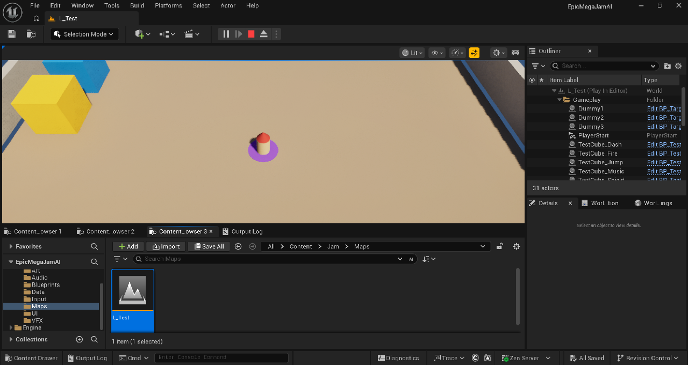.

### 07:46 · Console · Click on the beat.

PC played the test room on the PS5 pad and on keyboard and mouse: "it plays great". The beat now clicks, and a swing that lands on the beat rings a small bell. Both sounds came out of a twenty-line Python script, not a sound library. The honest hard part: the agent can build every system but can't press a single button, so "feels good" only exists once a human holds the pad. Screenshot: 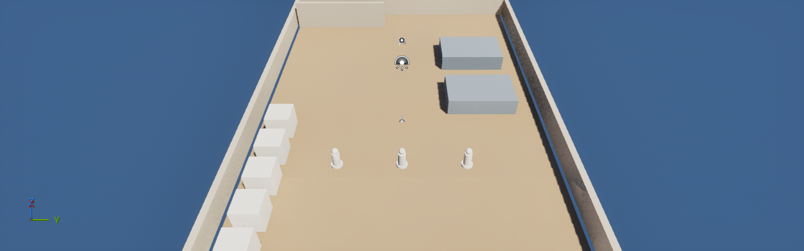 (the room as laid out: dummies, test cubes, the step and the gap, the dash wall).

### 08:10 · Console · Enemies that bite back.

Four toy enemies now walk, hop, charge and shoot: a grunt that winds up and lunges, a hopper that lands on you, a charger that aims, charges and stuns itself on walls, and a burner turret whose fireballs you can block or, with good timing, bounce back. Building them exposed a bug from yesterday: the code that asks "is this feature cut?" was never actually being run, so cutting Jump left you still able to jump. The test cubes sank, so it looked right. Lesson: check the wiring, not the effect.

### 08:26 · Console · The cut.

The station works up to the point a human has to press something: step on the platform and the planning board opens, "We're over scope. Cut one.", five sticky notes, each saying what you lose and what the game loses. Hold Square for 0.6 s and the note gets struck through, shrinks, a paper ball arcs into the bin, and the camera swings over to the next room to watch that feature's gates rebuild. The HUD at the bottom of the screen greys the note out for good. Screenshot: 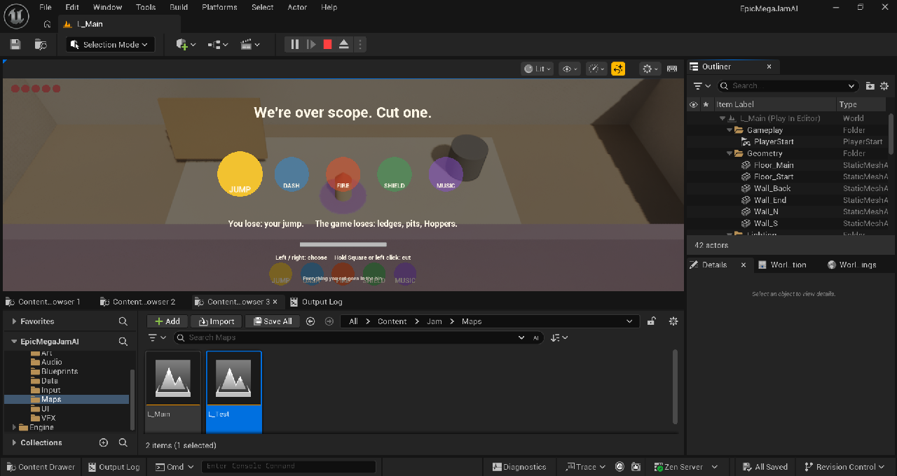.

### 08:33 · Console · Five gates, one room.

Room 1 exists: a pit with a raised far ledge (a dash smacks into its face), a lane of pumping blue plates you can only dash through, a cardboard barricade that only a fireball burns, a dart corridor you walk with your shield up, and a door with a three-light lock that only opens to three swings on the beat. The hard part was stopping one feature from skipping another's gate: the first dart thrower could be beaten by dashing in and swinging between darts, so now it only breaks right after you've blocked a dart. Tested by teleporting the hero around and reading back the hearts, not yet by a person.

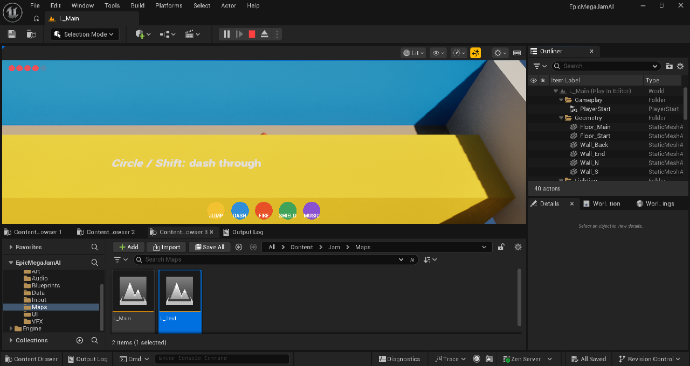

### 08:42 · Console · First packaged build.

The game now packages to a standalone Windows .exe (614 MB, 3.5 minutes). It took three tries: the editor's AI-connection plugin made the packager think this was a C++ project, and then the laptop ran out of memory cooking shaders for content we don't even use. Restricting the plugin to the editor and cooking only our one map fixed both.

### 09:55 · Console · The dart thrower fights fair.

PC's first run of the packaged build got all the way to the last obstacle and stuck there. The dart thrower only breaks to a swing right after you've blocked one of its darts, but the darts flew in a straight line down a corridor wide enough to walk beside them. So you never blocked, and the thrower never broke. Now every dart is aimed at you, and the thrower only fires while you're in its corridor. That second change came from the agent's own test: aimed darts also drained your hearts at the spot where they shove you back. A perfect block that bounces a dart back into the thrower now breaks it too. On keyboard, block moved from Q to the right mouse button (fire went to E), because holding Q while steering with WASD cramped the hand. The five sticky-note icons are in the HUD and on the cut screen. Screenshot: 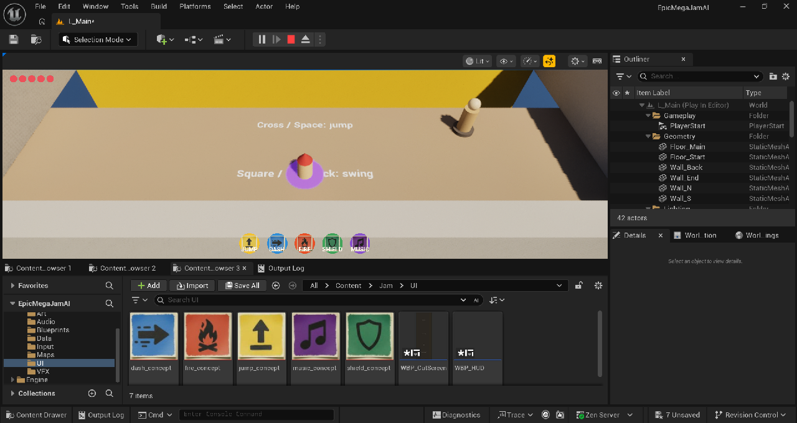.

### 11:50 · Console · Two more enemies and a ring.

The Guard (Shield) turns slowly and shrugs off anything from the front; a perfect block knocks its shield down for a second. The Drummer (Music) sends a purple ring along the floor every fourth beat: jump it, dash through it or block it. The boss will reuse the same ring.

### 13:05 · Console · Rooms 2 and 3 exist.

The level now runs past the first station: two more rooms with their gates in a new order, two more stations ("Still over scope. Cut another.", "We ship tomorrow. One more.") and a last fight in two waves. On the first try the station would have frozen after the throw: the graph tool had quietly swallowed one step. Reading the graph back caught it.

### 14:40 · Console · Feature Creep climbs out of the bin.

The boss exists. When you walk into the round arena the door shuts behind you, the bin tips over, a grey heap rises and the parts of the features you cut bolt onto it one by one: yellow springs, a blue bumper, orange flame arms, a green shield plate, a purple drum. Then the card: "FEATURE CREEP. It all came back." It cycles through those parts in the order you cut them, and only opens up to your swing between attacks. The first screenshot showed nothing but a wall: the camera looks over the hero's shoulder, so the arena's near walls hid him. Those walls are now invisible barriers with a low rim you can see over. Screenshot: 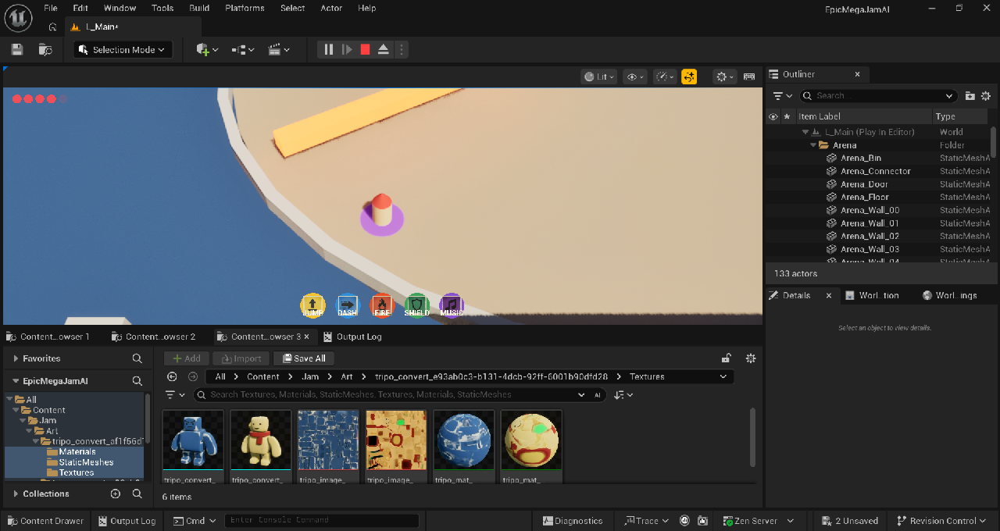.

### 15:20 · Console · A beginning and an end.

The game now opens on a title card, "OUT OF SCOPE, a game by Ravine, press any button", and finishes on "Director's Cut: version 1.0": what you shipped, what you cut and in which order, your time, and how many hearts it cost. One button plays again with a clean slate. Screenshot: 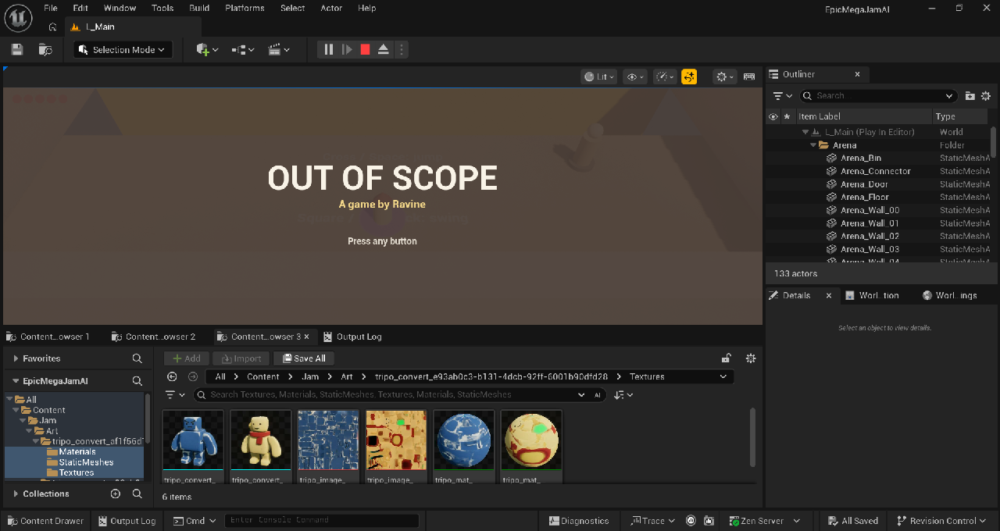.

### 15:55 · Console · The soundtrack gets cut too.

The music now plays in four layers that start together and restart together every 32 seconds, and the Music feature's beat clock restarts with them, so on-beat hits line up with what you hear. Each cut fades one layer: melody first, then bass, then drums. Cut Music itself and everything but the bed drops at once. When Feature Creep climbs out of the bin, every layer comes back, a little louder. Swings, dashes, jumps, landings, hits and the paper crumple of a cut have their sounds now.

### 16:55 · Console · You can see when the boss can be hurt.

PC couldn't beat Feature Creep on the first full run and couldn't tell whether anything was hurting it. Two causes. Nothing on screen said when the boss was open. And a swing only reached 180 from the target's centre, while the boss's core is 120 wide, so standing against it left about 20 of reach. Now a health bar sits at the top of the screen with the boss's name. While it can be hurt, the frame pulses gold and OPEN shows beside it; otherwise it says CLOSED. The core is dull grey when shut and glows cream-white when open, with a two-note chime as it opens and a thud as it shuts. Hitting it while shut gives a dull thunk and a little grey spark, and the first time that happens, "Wait for it to open." appears under the bar. A hit that counts throws out a puff of cream paper squares. The Shield attack no longer needs you behind it: it pushes forward for 4 s with its green plate pulsing, then stays open for 3 s. A perfectly blocked shot bounces back for 2 damage even while it's shut. The boss has 24 HP instead of 30, stays open 2.5 s (1.8 s when nearly beaten), and drops a heart in the middle of the arena at half health. Screenshot: 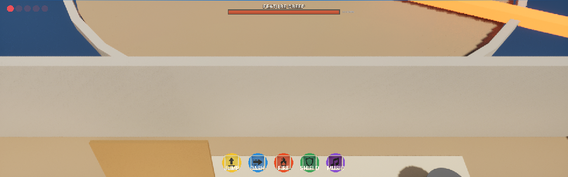.

### 17:40 · Console · You can always leave.

On the first full run PC had to kill the game from Task Manager because the pause screen had no way out. Pause (Options or Esc) now opens a menu: Resume, Restart run, Quit to desktop. It works with the pad (the focused button glows orange) and with the mouse. The title and the end card take Circle or Esc to quit, and have a Quit button in the corner for the mouse. The floor prompts, the cut screen and the title and end-card lines now show either pad or keyboard wording, whichever you touched last, instead of both at once. Screenshot (in the editor's designer): 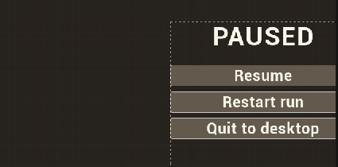.

### 18:10 · Console · Hits that feel like something.

A juice pass, using only engine shapes. Every hit on an enemy throws out a burst of small cream paper squares. Enemies break into six chunks in their own colour, which scatter, bounce on the floor and shrink away. The hero kicks up a little dust when landing, leaves three blue after-images when dashing, and fireballs leave a short orange trail. Losing a heart flashes the screen edges red. When a gate breaks or rebuilds, the camera shakes a little and dust puffs along it. At a cut station, time drops to 0.3 for the pen stroke, and the paper ball lands in the bin with a thump and a puff of scraps. The camera now leads the hero by a short distance in the direction he's moving. No screenshot: the effects last under a second and need someone playing to catch them; PC's next run will tell whether they read.

### 18:59 · Desktop · Feature Creep gets a body.

The boss's core was a grey cylinder. We gave Hyper3D Rodin the approved concept painting of Feature Creep, a hunched toy made of sticky notes, tape and spare parts, and asked for a chunky hand-painted toy with no text, at most 30,000 triangles. One try, about three minutes. What came back is clearly him: the frown, the two dot eyes, the heavy taped fists, the wheel, spring and wind-up key on his shoulders, all the note colours. Three things are off. The tin bin from the painting came with him, as a separate piece that eats 13,000 of the 30,000 triangles, and it came out black instead of tin. His back is mostly bare wood with few notes. And the key's two loops now stick out on both shoulders, where the painting has a hook on one side. Getting there took two tries of a different kind: the upload was blocked twice by network rules until PC allowed Hyper3D's file server. Screenshot: 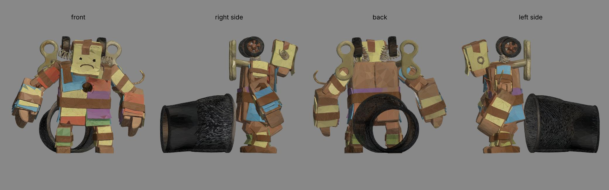.

### 19:00 · Console · The toys get their faces.

The hero and the grunt are no longer stacks of engine shapes. They are now the textured models PC made from our concept art in Tripo: the hero a cream wind-up toy with a red scarf and a brass key on his back, the grunt a blue blocky robot. Both stand on the same spot as before, at the size the brief asks for (hero 120, grunt 110), facing the way they move, so the procedural bobbing and tilting and the red hit and telegraph flashes still work. The first try had them facing backwards; a test from the front showed the hero's key where his face should be. The other enemies keep their placeholder shapes until their models are fitted. Screenshot: 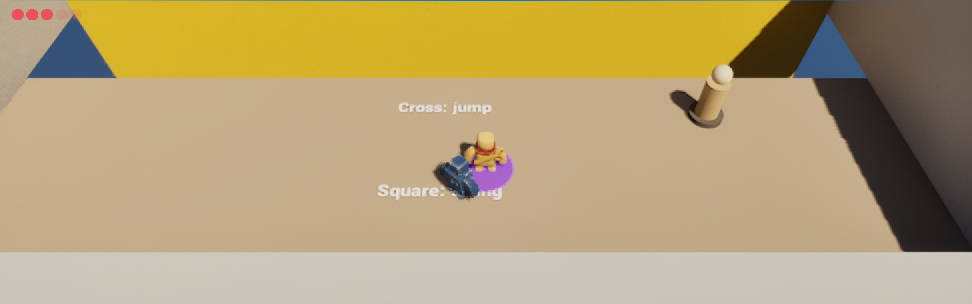.

### 19:15 · Codex · The boss gets its bolt-on toys.

The first Jump, Fire and Music concepts included the hero. The standalone revisions gave Tripo just the parts to model. All five textured modules now fit the 8,000-triangle limit. Fire came through as a single twin nozzle for the top mount. Source model turnarounds before fitting in Unreal: 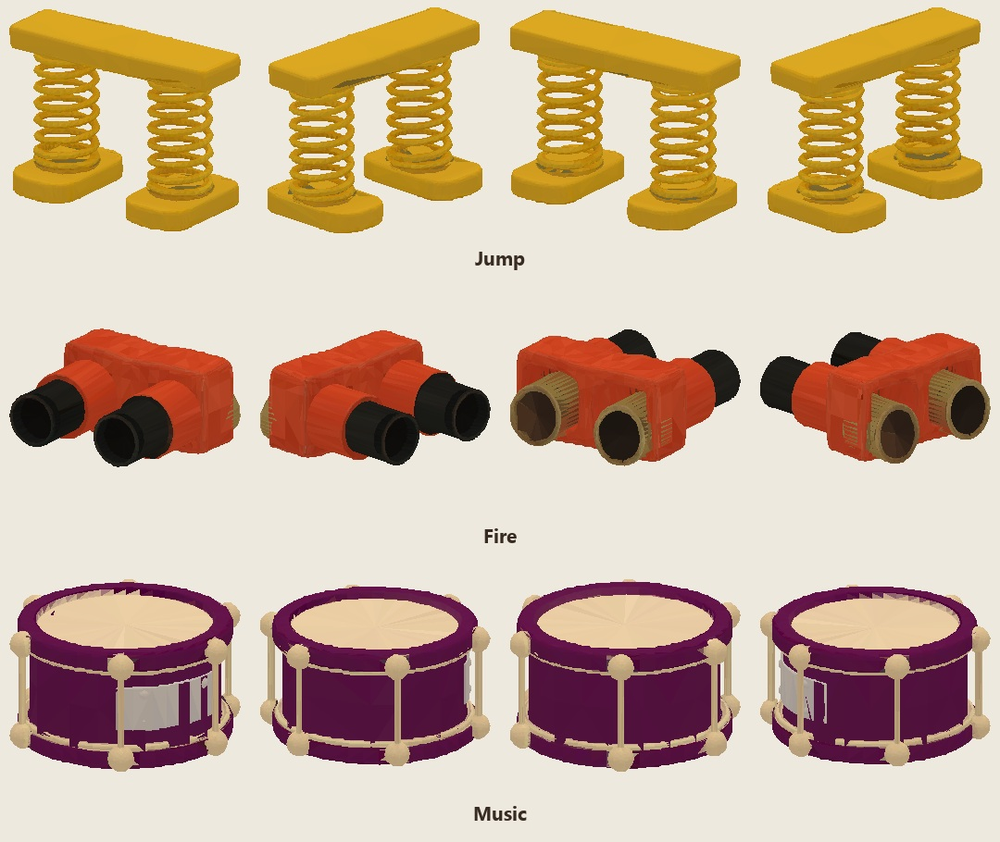.

### 19:25 · Console · The producer speaks.

Until now the first words a player read after the title were button prompts, so nothing said what the game was about. Now a cream sticky note slides in at the top right, tilted like it was slapped on the screen, signed "FROM THE PRODUCER": "It's all in. Every feature we ever pitched. Go and play it." Five more notes follow at the moments that matter: when you step on to the first cut station (the cut screen now waits 1.5 s so you can read it), after each of the three cuts as the camera comes back to you, and the first time you die ("Take it again from the door. Your cuts stand."). The notes never stop the game and never take input; a new one replaces the old. PC approved the six lines before they were built. First try at reading the note back failed because the test calls took longer than the note stays on screen; the text it had shown was read from the widget instead. Screenshot: 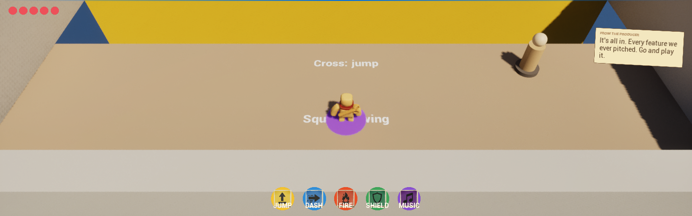.

### 20:01 · Console · The whole cast is real.

The last five enemies swapped their engine-shape bodies for the Tripo models: the Hopper on its spring, the Charger as a little blue car with its ram leading, the Burner with its cone hat and chest nozzle, the Guard behind his shield, the Drummer with his drum. They keep their old capsules, ranges and speeds, so the fights play exactly as before. Three things needed more than a mesh swap. The models don't all face the same way: the Hopper came out backwards compared with the others, and we only found out by putting the camera at head height and finding the frown under his hat brim. The Guard's shield is now part of his body, so a perfect block no longer knocks the shield off; instead the whole Guard tips back and flashes green for a second. And the Hopper now squashes when he lands and stretches when he takes off. Screenshots: 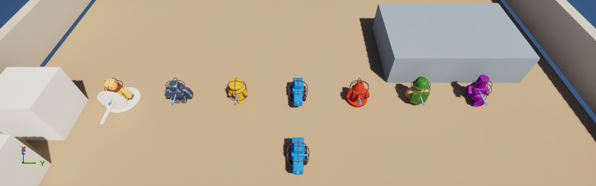 (everyone in a row, from the game camera's height) and 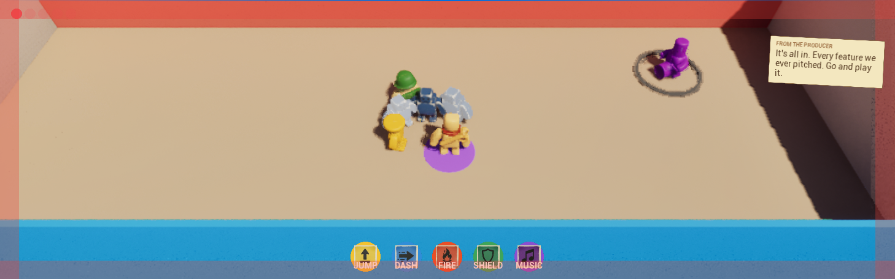 (a real fight in Room 2).

### 20:15 · Console · Everything makes a noise now.

Codex's second batch of 22 synthesised toy sounds (wood, tin, bell, drum and paper resonators, no samples) is wired into the game, plus a percussion layer that only comes in while you fight Feature Creep. Throwing a fireball, blocking (and the bell of a perfect block), losing a heart, dying, picking up a heart, the pen stroke and the ball landing in the bin, every gate as it rebuilds or breaks, doors and barriers, enemies winding up and breaking, the ground rings, the boss putting himself together and falling apart, moving and confirming in the menus, and a soft paper rustle when the producer's note arrives. Twenty enemies telegraphing at once would be a wall of noise, so those sounds are capped at two per tenth of a second. A cut rebuilds every gate of that feature in the same frame, so gate sounds are capped too. We can't hear any of it from here: the first listen is PC's. No screenshot; it's sound.

### 20:43 · Console · Feature Creep gets his body.

The boss was a grey cylinder with a paper heap on top. Now it's the Hyper3D Rodin model: a hunched toy made of sticky notes and tape, frowning, with a wind-up key and wheels on its shoulders. Rodin gave it to us with a tin bin stuck behind it, almost half the triangles and black. A short script found that the bin was a separate piece of the mesh (13,318 triangles, all behind and below the creature), cut it out, and moved the pivot to its feet: 16,682 triangles left. The old cylinder is still there, invisible, so everything that hits or gets hit works as before; the model rides on top of it and inherits its growing, sagging and collapsing. A grey cylinder could show "open" by turning bright; a painted model can't, so closed now puts it in shadow (its colours at 45%) and open lights it up cream-white and pulsing. First try imported him lying on his side. Screenshots: 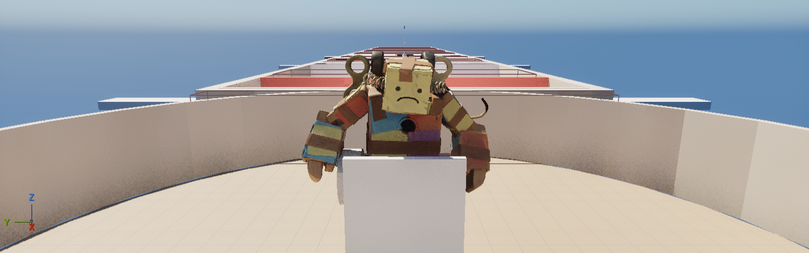, 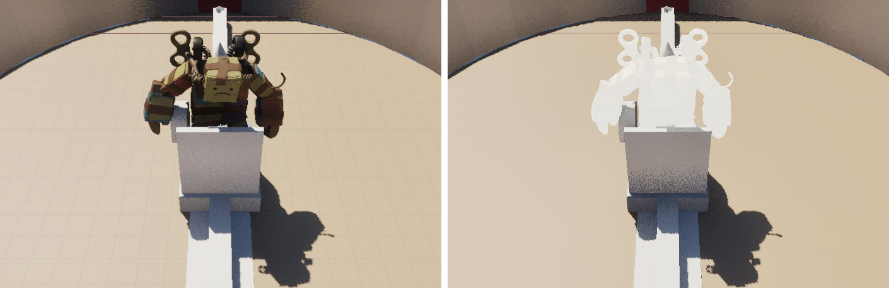.

### 20:49 · Console · The boss wears what you cut.

The five feature modules Codex made in Tripo now bolt on to Feature Creep instead of engine shapes. Each one appears only if you cut that feature: a blue carriage with a ram under its feet for Dash, yellow springs around its ankles for Jump, a red twin-barrel head for Fire, a green shield on its left arm for Shield, and a purple drum on its chest for Music. The drum's silver side plate had fake lettering on it, so it's turned to face the floor, where the camera never sees it. Their colours are kept strong, because they're how you read which of your cuts came back. Screenshots: 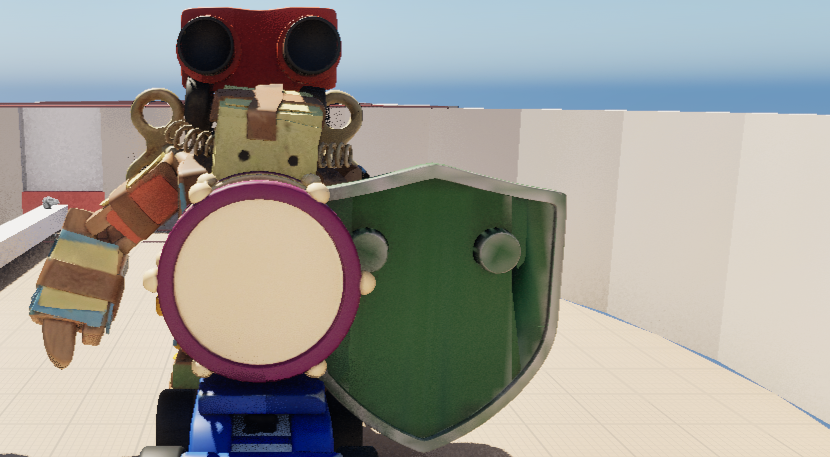 (front), 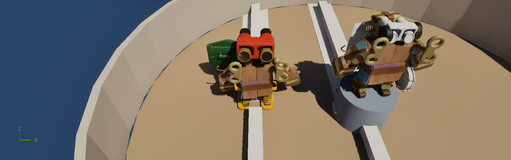 (from the player's camera).
