# Day 2 — Fri 13 Nov

### 05:41 · Console · The prototype moves onto a desk.

Until tonight the game looked like a test level: beige floor, grey walls, a blue sky behind. Now it sits on a designer's desk. The rooms are a green cutting mat with a faint grid, the walls are wooden blocks, the arena is a round cork coaster, and the station platforms are cork. All four surfaces are one material we wrote in the engine: no textures, just noise and grid lines in world space, so a single setting covers pieces of any size. The sky is gone; past the desk the world fades to dark brown. One warm desk lamp lights it from the upper left, with a cool fill so shadows stay readable. The camera's depth of field now keeps a thin band sharp around the hero, the miniature trick. What went wrong first: the blur didn't appear at all. At our camera's wide view a real lens keeps almost everything in focus (about one pixel of blur), so the virtual sensor had to be made much bigger. Then it still didn't appear, because the editor runs at Low quality on this laptop, which switches depth of field off (the packaged game runs at Epic). The first wood and cork were too orange under the warm lamp and started to look like the Fire feature, so they're browner now. The button prompts on the floor are bigger and moved off the hero's path. Before: 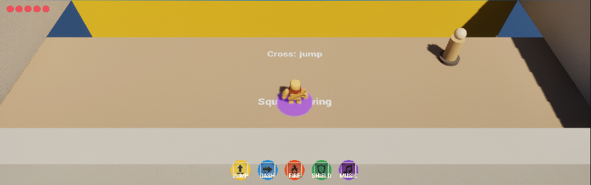, 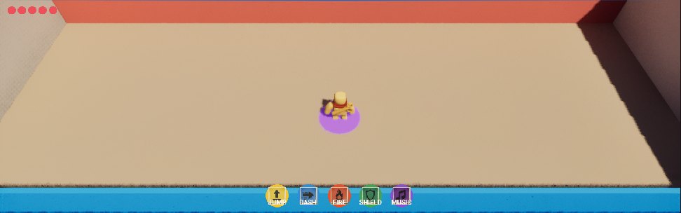, 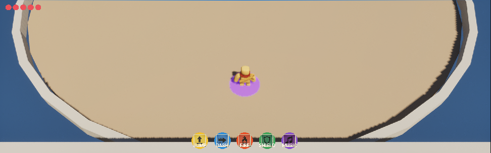. After: 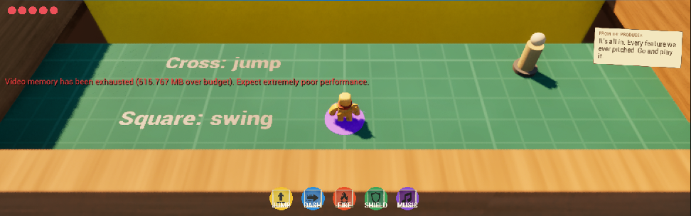, 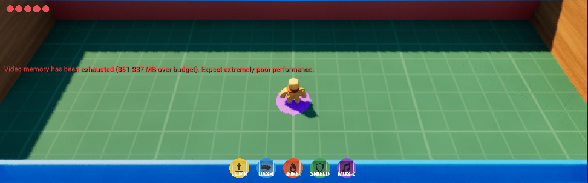, 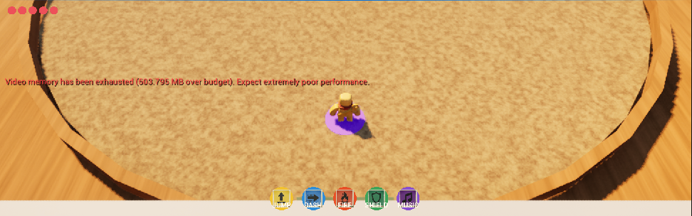.

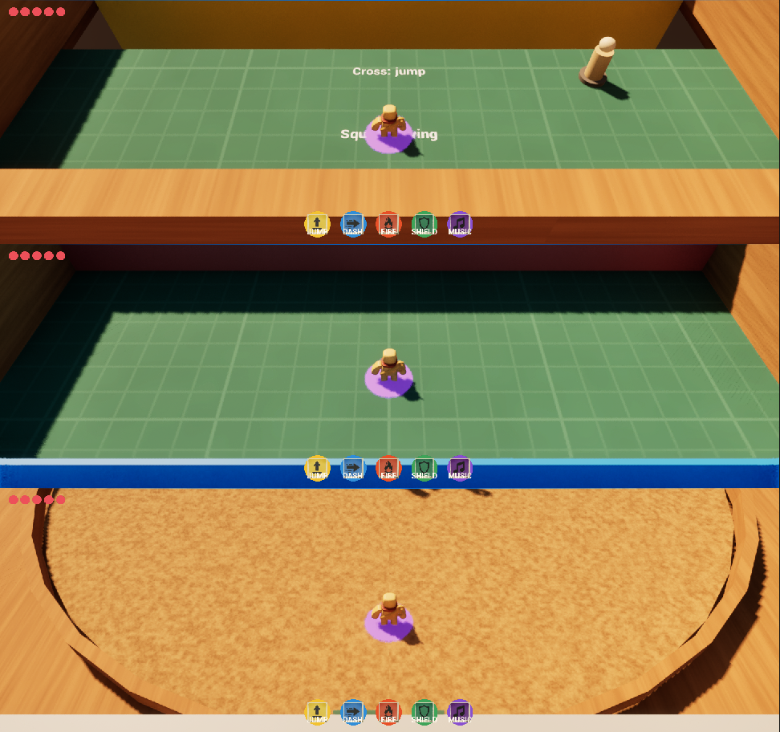

### 05:50 · Codex · Paper screens for the desk

Tripo put a toy in the middle of the corkboard and painted the first cover boss red. We rebuilt the empty cork from the board itself and used the Rodin-like banner boss for the cover. PC review sheet: 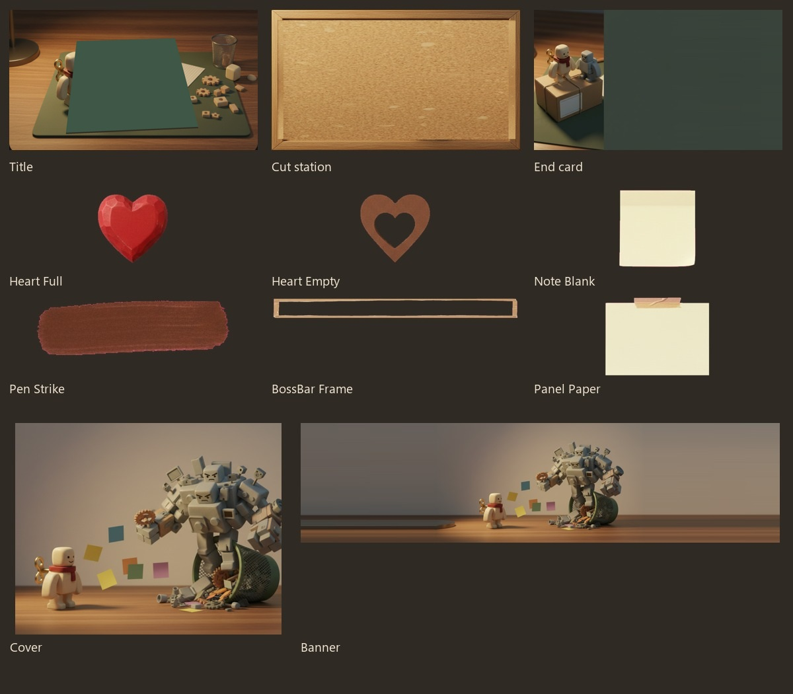.

### 08:42 · Codex · Feature Creep on the desk

The first screen pass hid the hero and turned the paper boss into a robot. We rebuilt the title around the bare mat, put the hero alone on the box and used the approved paper creature and bin concepts for the page art. A generated bin edit changed the cast, so we refinished the tin on the original composition. Review capture: 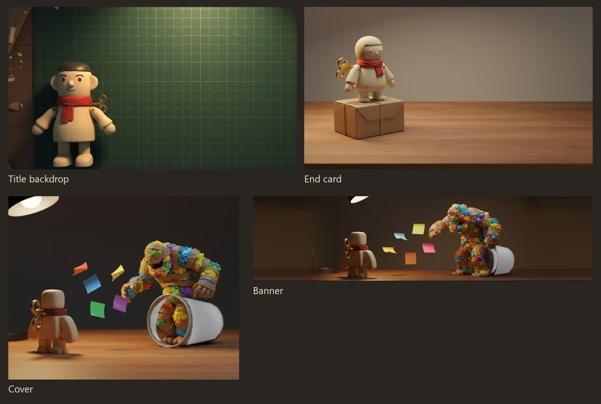.

### 08:51 · Codex · The title on the cutting mat

One guided edit added a camera and a second figure. Cropped the original mat for the title and imported the hero-on-box end card. Preview: 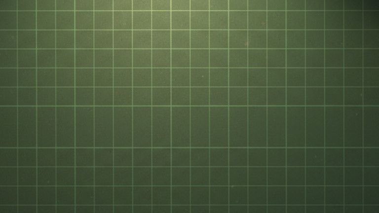.

### 08:57 · Console · Three colours pulled back before the build

Under the warm lamp the cork read as orange sand, so three values changed before the day's package. The desk lamp went from 4,300 K to 5,000 K, the cork got duller and darker until it read grey-brown, and the cutting mat went about 15% darker. One thing we left alone: the hero still looks golden at game size. The shot from before the lamp existed shows him golden under a neutral sun too, so the lamp isn't the main cause. Written up by Fable from Console's journal.
Screenshots: 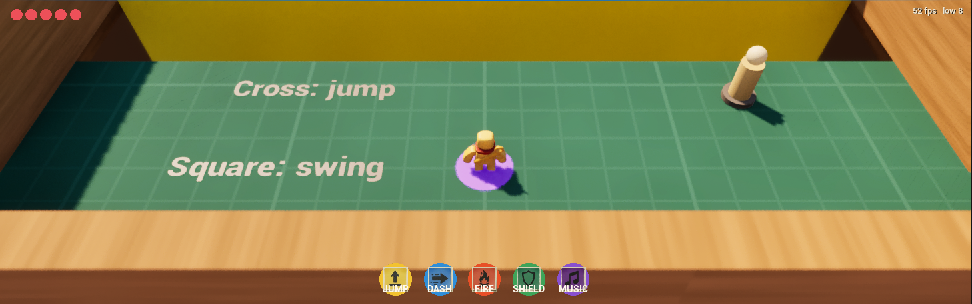, 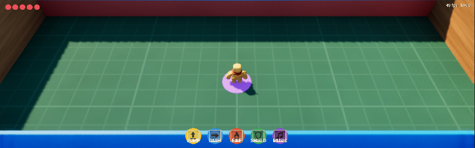, 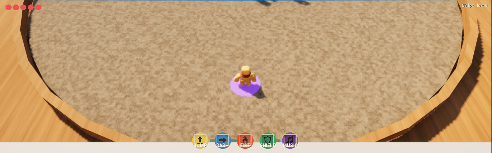

### 11:05 · Desktop · The cut station gets its furniture

We asked Tripo for an empty corkboard on an easel, a tin bin and a heap of crumpled notes in the five feature colours, each painted to match the style key. The first board came back with our hero standing beside it, copied out of the style key; the second added a different wind-up toy. Tripo's image edit removed it, and every prop prompt since says "an object, not a character". The metronome for the Music gate came back mostly bare wood with no pendulum, so we asked for it purple all over. In 3D the board kept all three legs and the bin came back open, so the notes can pile up inside it, but its grey tin turned beige. Each model cost 40 credits and sits under 5,000 triangles. Preview: 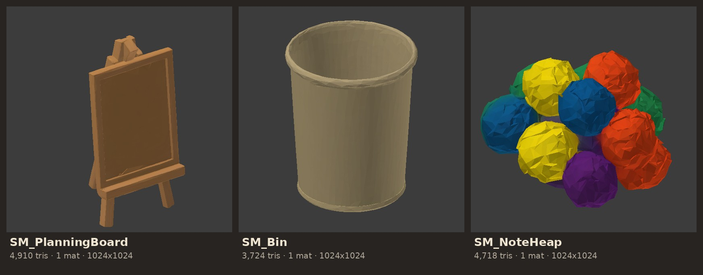.

### 11:06 · Console · The screens stop being grey boxes

Codex's paper and desk pictures went into the seven screens: the title sits on the cutting mat, the cut screen is a cork board, the hearts are real hearts with an empty outline left behind when one goes, every feature note is a paper note in its colour, a cut is a red pen stroke, the boss bar has a wooden frame that glows gold while the boss is open, the pause menu is a taped-on sheet and the end card shows the hero on his shipping box. Two things didn't work first time. The title mat was olive next to the teal mat in the game; a tint fixed the hue but can't brighten it, so the title stays a shade darker. The boss bar's frame was too thin to see at first, so it now draws at the picture's full size. Cream "PAUSED" on cream paper vanished, so that one word is in brown ink. Previews: 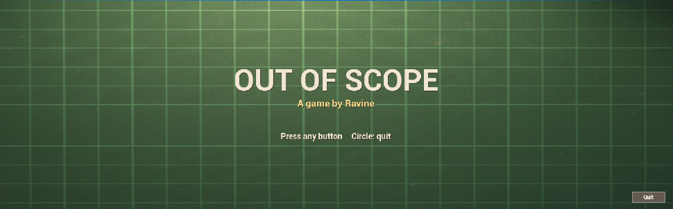, 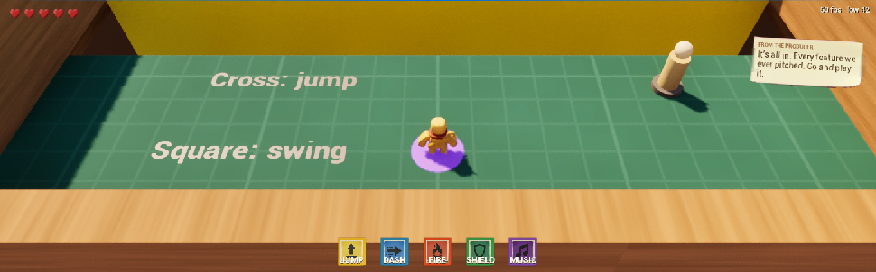, 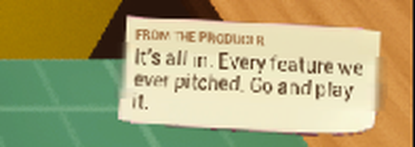, 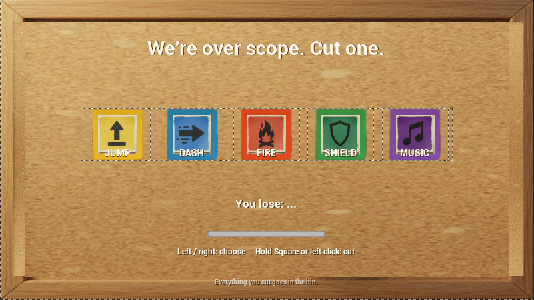, 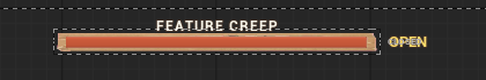, 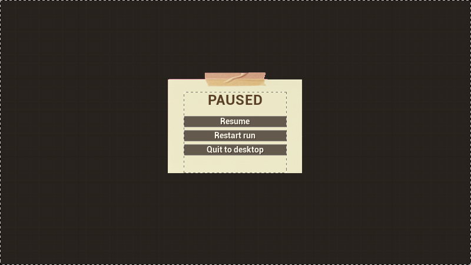, 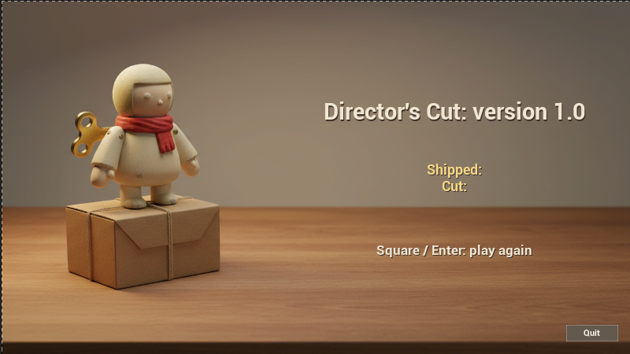.

### 11:20 · Desktop · Four gates, one colour each

The blade, barricade, dart thrower and metronome went from approved concepts to 3D at 40 credits each, all under 5,500 triangles with one material. Thin parts survived: the pinwheel's paddles, the barricade's string and the metronome's pendulum. The Dash blade came out a darker navy than the Dash blue, the only colour drift. Preview: 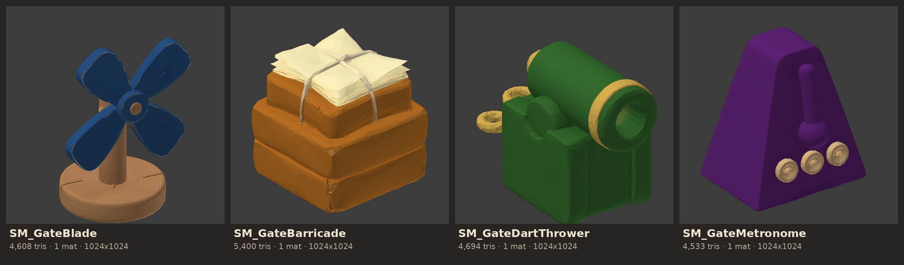.

### 11:21 · Console · The producer makes a review build

The developer couldn't reach his own boss. He likes the game hard and it stays hard, but a judge with fifty games to play won't see the boss if we leave it like that, and the boss is the whole point of the theme. So the title now has a sticky note: REVIEW BUILD ("Go easy on them. — The Producer"), or press Triangle for the DIRECTOR'S BUILD ("As designed. No mercy."), which is the game exactly as it was. In the review build the boss doesn't get its health back when you die, its openings last half a second longer, you're safe for twice as long after a hit, fights don't grow as you cut features, every cleared fight drops a heart, and if you die twice in the same room the producer simply cuts the fight you died in. We tested that last one by dropping the hero into Room 1's pit ten times: on the second death the barrier dropped, a heart appeared and the note said "We don't have time for this. I've cut that fight." The end card says which build you beat. Previews: 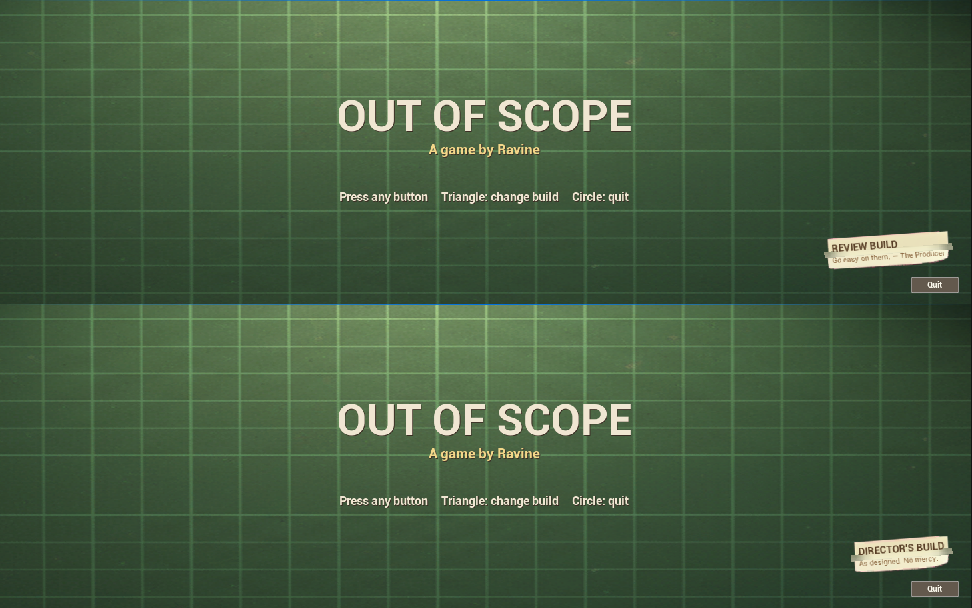, 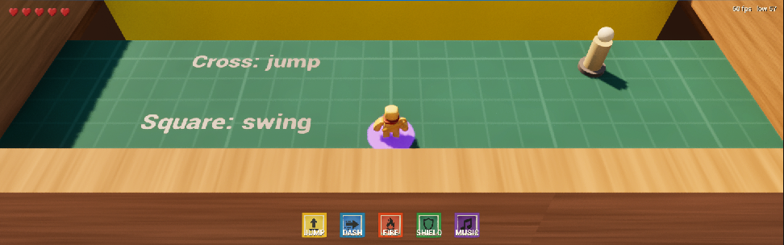.

### 12:00 · Desktop · The desk fills up, and the die turns yellow

Six desk props went to 3D: die, pencil, mug, tape roll, note pad and eraser, each under 3,000 triangles. Two needed edits first: the mug's rim came back terracotta (too close to the Fire orange-red) and was repainted dark brown, and the die showed the same number on two faces. Asking Nano Banana to change one face changed another too; a second edit made them all different. The surprise came after 3D: Tripo's texturing turned the cream die golden, almost exactly the Jump yellow, which dressing may not wear. Every prop came back warmer than its concept. Preview: 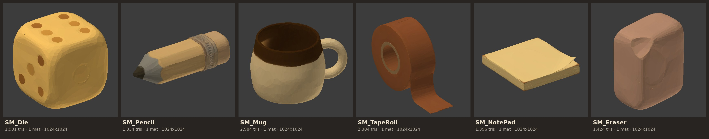.

### 12:40 · Console · The cut station is a real planning board now

The grey boxes are gone from the stations and gates. Each station has Desktop's planning board on its easel and a tin bin; the paper ball now lands in the bin's mouth, and a heap of crumpled notes in the five feature colours rises in the bin as the cuts add up. The bin Feature Creep climbs out of is the same tin bin, made big. The Dash lane is a field of blue toy windmills that pump up and down and sink into the floor when you cut Dash; the Fire gate is a wall of red blocks; the Shield corridor ends in a green toy cannon; the Music gate's lock is a purple metronome. Every model is only for show: the old boxes are still there, invisible, doing the collision, so nothing about how a gate plays has changed. Two things fought back. The bin came out beige and the windmills came out wooden, and our material could only darken a texture, so we gave it a tint that can also push a colour up. And the cannon pointed its barrel away from the hero until we turned it round. The last sounds are in too: the boss now has its own open, close and thunk, the beat clicks and chimes, the producer's notes rustle, the title has a sting, the end card has a victory, and the melody alternates between two versions every loop. Previews: 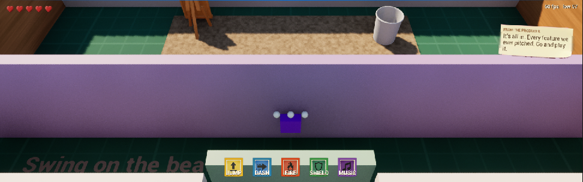, 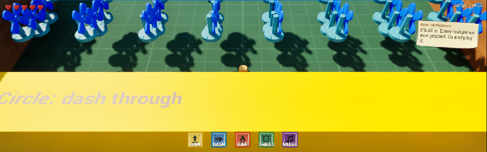, 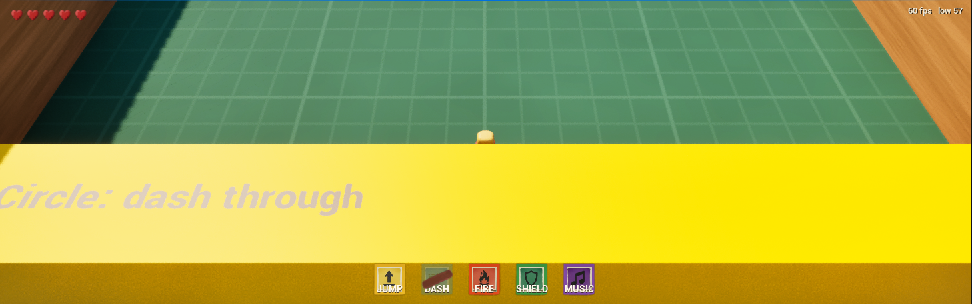, 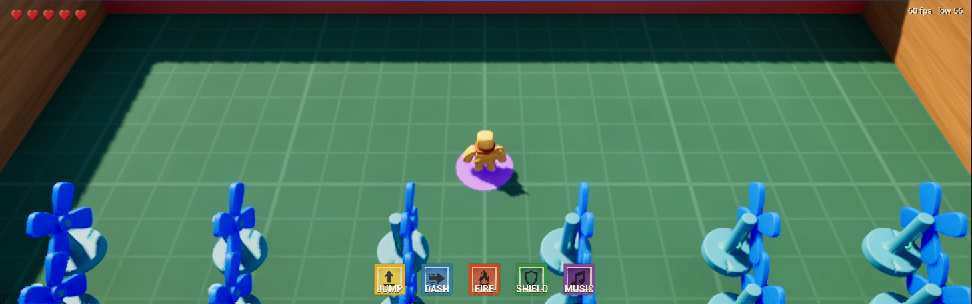, 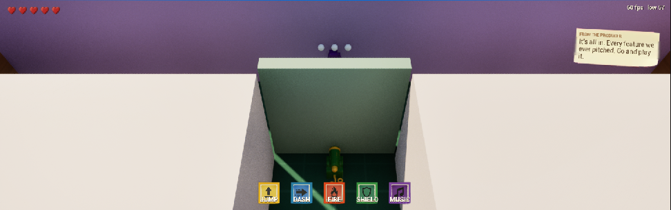, 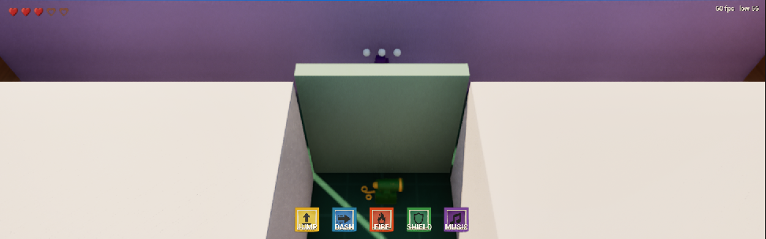.

### 17:00 · Console · DLSS: tried, failed, cut

PC measured the packaged game on the laptop it has to run on (RTX 2050, 4 GB, 1080p): 58 to 62 fps everywhere, with dips to about 45. The plan for those dips was NVIDIA's DLSS plugin, which would also have put us in the running for the NVIDIA award. The first download turned out to be an empty file. With a complete one, Console packaged the game three different ways, and every time the result ran fine and had no DLSS in it. The reason is the project itself: a Blueprint-only game ships with Epic's stock program file, and a plugin with its own code can only ride along in a program we compile ourselves. That means turning the project into a C++ one two days before the freeze. PC cut it: "the NVIDIA award will probably go to someone showing more innovation in graphics, and we have a low-poly game." Everything was put back, and Lumen reflections were switched off instead, since nothing on the desk is shiny. A game about cutting features lost one of its own. No screenshot: nothing a player sees changed. Written up by Fable from Console's journal.

### 18:56 · Desktop · The developer's desk has his things on it

The toy level now sits among a developer's real things, at real-thing scale beside a 120-tall hero: a 600-tall mug at Room 1, a 1,400-long pencil along Room 2, a 400 die by Station 2, a tape roll by Room 3, a notepad by Station 3, an eraser, and a 900-tall desk lamp leaning in over the boss arena. The die's yellow paint was too close to the Jump colour, so a tint in its material turns it paper cream. The tape roll stays on its edge, because its loose tail is modelled lying on the desk. First version had three props on the camera's side "to be safe"; reading the camera arm showed it looks straight down the corridor from behind the hero, so nothing outside the walls can block the view, and they went back. This was also Desktop's first job inside the editor: full-window screenshots were too big to send back, so the engine now writes them to disk (HighResShot) and they're read from there.
Screenshots: 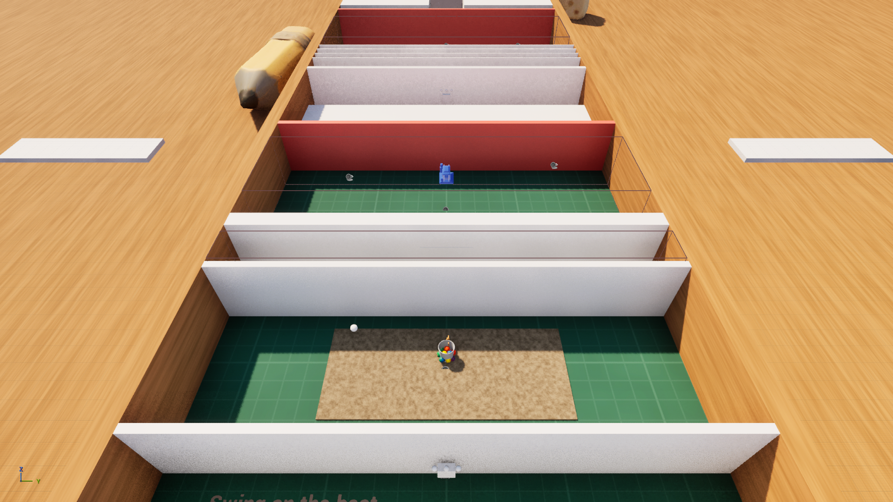, 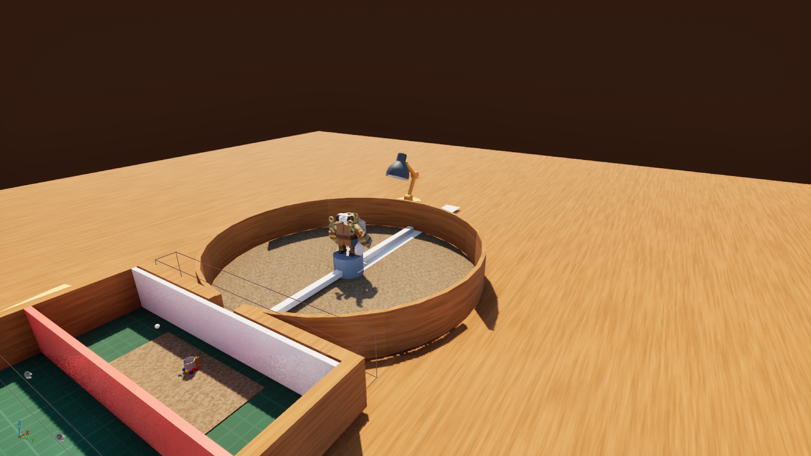, 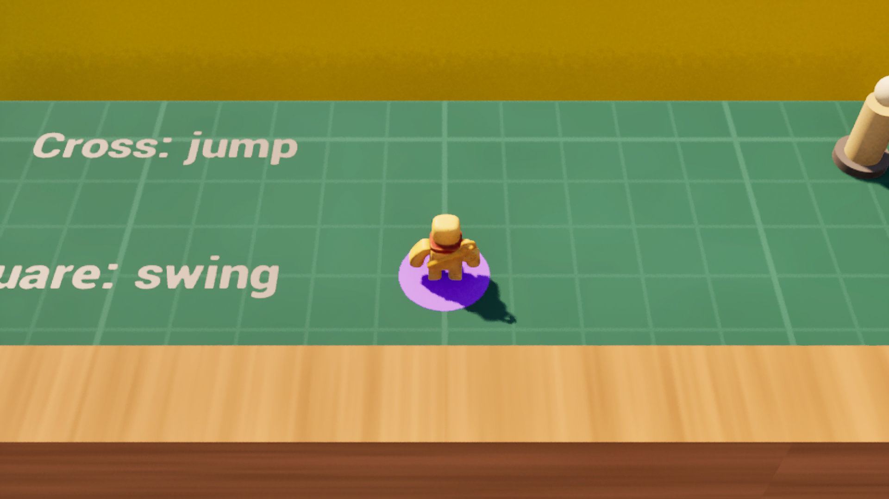

### 19:50 · Desktop · The page art is the real game

The itch.io cover, banner and five page screenshots are frames of the actual game, not generated art. Cover: Feature Creep built from three cut features (Dash wheels, Fire arms, Music drum) charges out of its bin at the small hero, with the desk lamp leaning over the arena wall behind; the top third stays dark for the title. Banner: the whole toy level stretched along the desk, the tape roll and die on the desk beside it, the boss in its arena at the end. Page shots: Room 1 with all five notes, the cut screen, a gate rebuilding the moment a feature is cut (its note gets the pen stroke), a fight in Room 2, and the boss fight with its bar. What failed first: the editor's own screenshot tools were too big to send back to the agent, a camera placed for the cover couldn't become the game's view without a Blueprint change, and the boss kills a hero who stands still within three seconds, so every boss frame had to land in the first two. The editor camera has no depth of field, so the miniature blur on the cover and banner is a tilt-shift added in the crop script; unblurred versions are kept.
Screenshot: 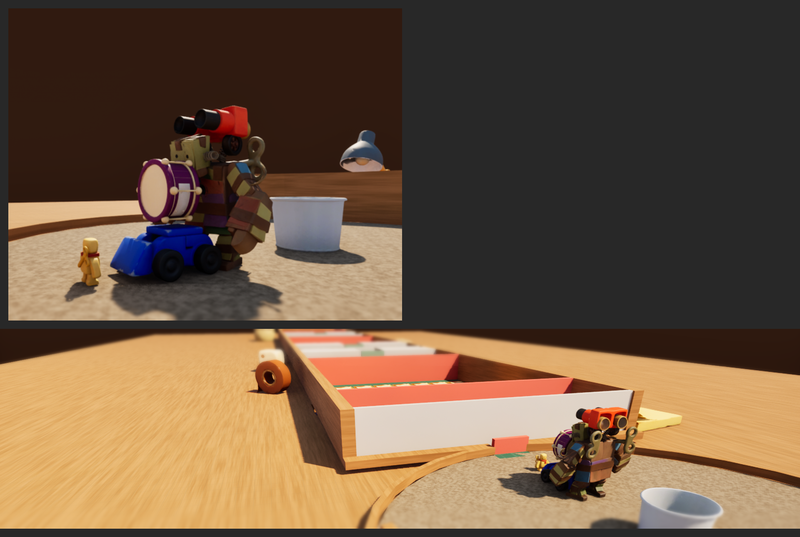 (cover and banner on one sheet); files in `Jam/Page/`.

### 20:45 · Console · A rehearsal for Sunday

Sunday's final package will be the first with the debug tools switched off, and we didn't want to learn on Sunday what that breaks. So tonight we built it once for practice: RC1. Codex's attempt stopped before it began; Console then ran the same steps with the editor closed. No errors, 2 minutes 53 seconds, 632 MB, 340 MB zipped without debug files, and it starts from a freshly unpacked folder. The debug switch went straight back on, because PC still needs the shortcut to the boss for testing. What nobody has checked yet is that the debug keys really do nothing in RC1. That needs a person. No screenshot. Written up by Fable from Console's journal.
