# Day 3 - Sat 14 Nov

### 08:05 - Console - The boss dies for the first time
Until this morning nobody, human or agent, had seen Feature Creep die. Console fought it the slow way: boss health lowered from 24 to 4 for the test, the game slowed to a fifth of normal speed so a script could catch the 3-second window when the boss opens, then the hero was put in front of it and swung. Every hit went through the game's own damage path. What failed first: the swings did nothing, because typing the slow-motion command had moved keyboard focus out of the game. Then the slow motion kept switching itself off, because every hit's hit-stop sets game speed back to normal. It took two runs and two different sets of cuts, and in both the boss dropped one heart at half health, fell apart and left nothing behind, and the end card listed the right features in the right order. Enter brought back a clean run each time. Reading the log afterwards turned up one real bug: the material most of our toys share wasn't marked for the instanced meshes the ground ring uses, so in the packaged game the ring would most likely have drawn with the engine's grey grid. One checkbox fixed it.

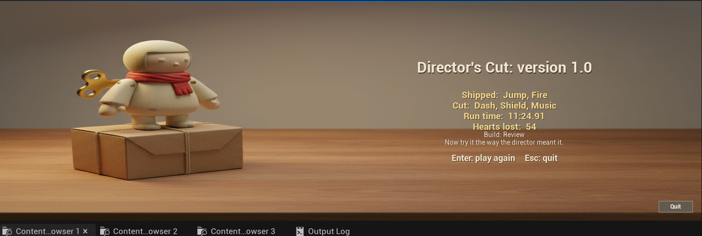

### 09:10 - Console - The boss falls apart
The design said Feature Creep "falls apart into its pieces"; until now it squashed, wobbled and vanished. Now the moment it reaches zero health, cream and feature-coloured scraps burst from its chest; then every half second one of the features you cut pops off its body, and a shower of that feature's colour lands and bounces on the cork; at two seconds the body bursts into thirty bigger pieces and the camera shakes. It is all done from outside the boss by the same little paper-burst kit the enemies use, so none of the boss's fight code changed and its death keeps its length. What failed first: the module pops came out of the floor, not the boss, because each module's pivot sits at ground level; they now start from the module's middle. The pieces were also too small to read against a boss this size, so they grew from 22 to 30 cm. Catching it on camera needed the killing blow's hit-stop stretched for the test, which plays the whole death at one-twentieth speed.

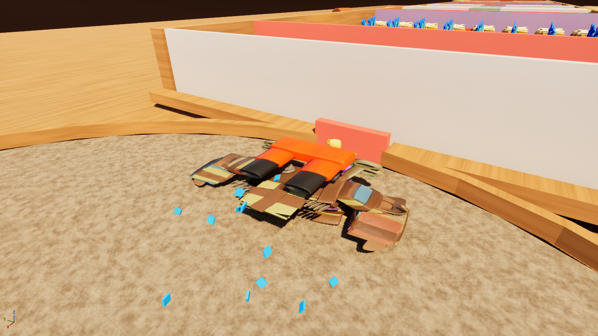

### 09:38 - Console - Shield and Music show on screen
Two of the five features only paid off by ear: a perfect block rang a bell and an on-beat swing chimed, but nothing on screen told you that you had timed it. Now a perfect block throws a short spray of Shield-green paper from the hero's front and flashes the hero green instead of the usual hurt red, and an on-beat hit throws Music-purple paper from whatever it struck, on top of the normal cream. The beat ring at the hero's feet already jumped on an on-beat hit, so that stayed as it was. Both are read from outside the hero, so the hero's own code didn't change. Neither could be filmed by an agent: a perfect block needs the shield held at the right instant, and the tools can only tap keys. PC's pad test is the first real look.
No screenshot.

### 09:51 - Console - Fire reads as fire
Fire had no fire: the fireball left a trail of orange dots, and a burning gate only pulsed. Now the trail's pieces drift upward as they shrink and fade from Fire's orange-red into paper cream, a fireball (the hero's or the Burner's) that hits something leaves a small orange-and-cream puff, a burning gate gives off rising embers until it flattens with a last puff, and the boss's sweeping flame arms shed a thin line of embers. Fire is never allowed to turn yellow, because yellow is Jump's colour, so the embers go from red to cream. What failed: rewriting one function through the agent's graph tool added a second copy of it instead of replacing it, so for a while every ember was spawned twice; the graph was cleared and written once. And looking closely at the arms showed they already glow yellow under the bloom, which breaks the colour rule; that one is noted for the next pass, not fixed here.

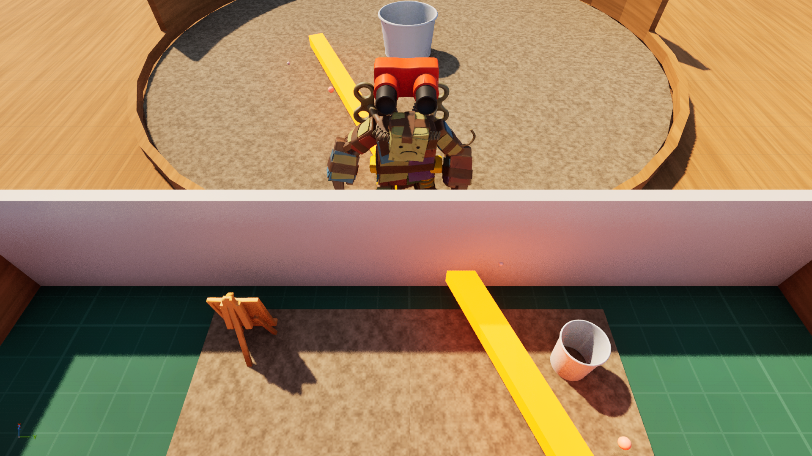

### 09:55 - Console - Scraps from the bin
Feature Creep climbs out of the producer's waste-paper bin, so the bin now coughs up cream paper scraps three times as it tips and the body rises, and each cut feature snapping onto the body throws a small puff of its own colour. Like everything else in this pass it is driven from outside the boss, by watching its intro clock. The first scraps were too small to see against the cream arena wall and were made half again as big.

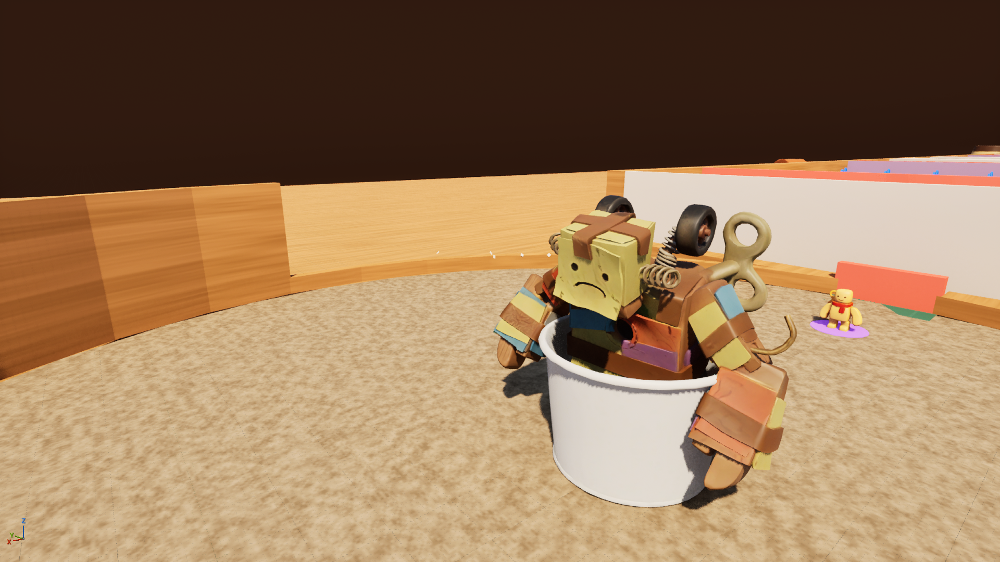

### 10:47 - Console - The last grey boxes
PC said some walls looked like prototypes; they were the pieces that move or block, still engine boxes in one flat colour. Using the desk fiction: fight barriers are now pale wooden rulers, doors are index cards, the Jump ledge is wood with Jump-yellow lines across its top (the edge you have to clear), the boss's charge lane glows proper Dash blue instead of cyan, and the beat ring under the hero is Music purple instead of lilac. Materials and colours only; nothing moved. What we learned: changing a Blueprint's material didn't reach any of the 31 copies already placed in the level, so each was set by hand; and the "white band" round the arena turned out to be the last station's 24-metre door.

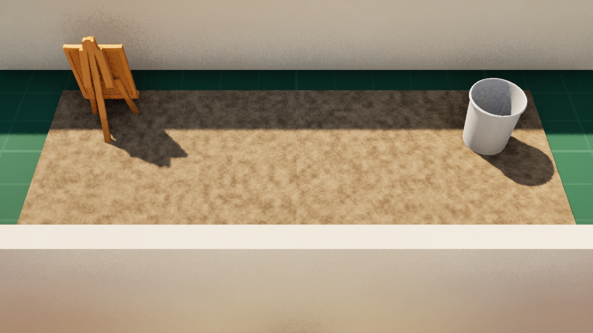

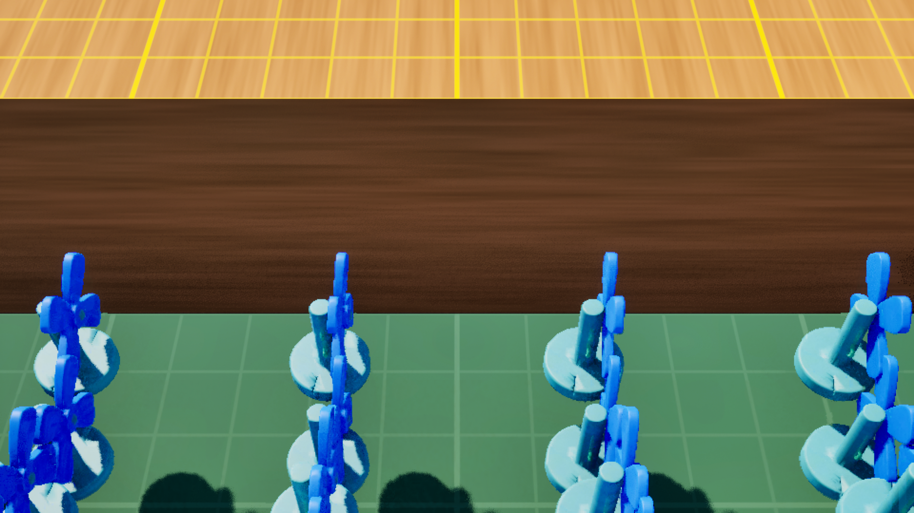

### 11:52 - Console - Polish, part A: what PC found
PC's own finds came first. The first cut station's camera showed only the flame wall: Room 2 is longer than Room 3, so copying the good camera's position wasn't enough, and it now sits higher and wider and takes in all five of Room 2's gates. Feature Creep now faces the arena door while it climbs out of the bin, and turns to face you, at most half a turn a second, while it winds up and while it's open; it doesn't turn before the flame-arm attack, because that sweep starts along its facing and would begin on top of you. Its death no longer snaps it round. The flame arms were glowing yellow, which is Jump's colour; first they went orange, and only when their glow came right down did they read as Fire's orange-red, because the screen's tone curve turns very bright red orange. And a plain table of what the boss actually does, written from its Blueprint for PC, found that the Shield attack has no shield at all any more: it's a slow chase.

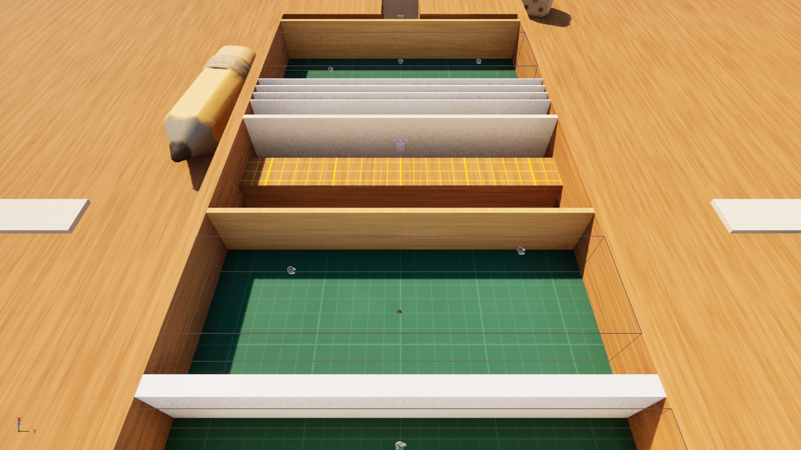

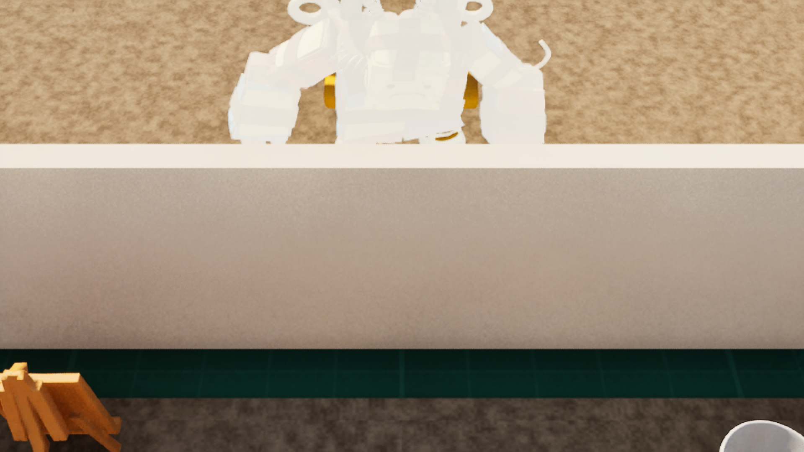

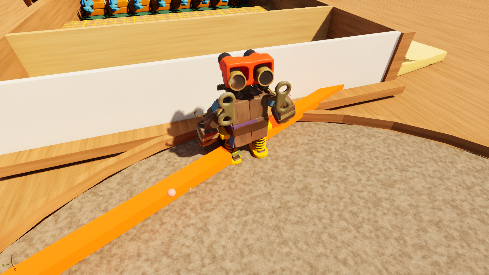

### 16:55 - Console - Polish, part B: the game reads and feels finished
The beat ring under the hero is now a real ring, not a filled disc, and the boss's charge lanes are see-through blue stripes, both from one new translucent telegraph material that the existing code drives without changes. The Room 1 floor prompts were shrunk so "Square: swing" is no longer cut off by the screen edge. The swing now leaves a short arc, a heart pickup a small red burst, and the hero's death a burst of paper. The 24-metre door across the arena mouth became a wooden ruler. What failed first: the material's one custom node refused to take its inputs in one go and had to be given them one at a time, and catching any of this on camera was mostly luck, because the moments last a fraction of a second.

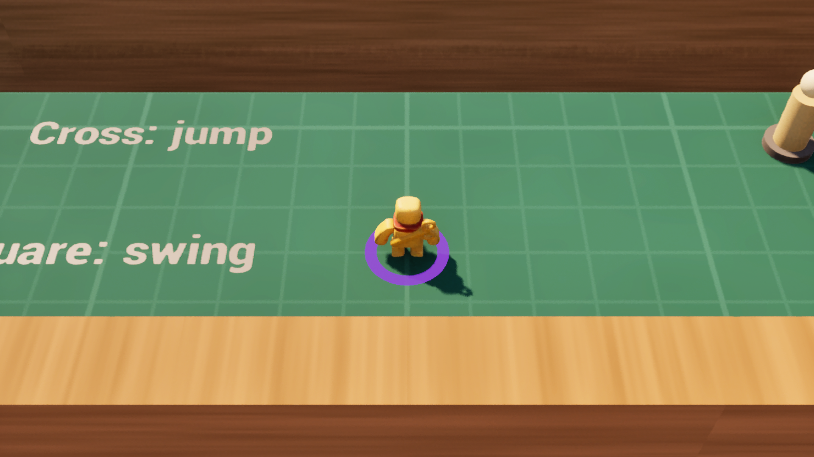

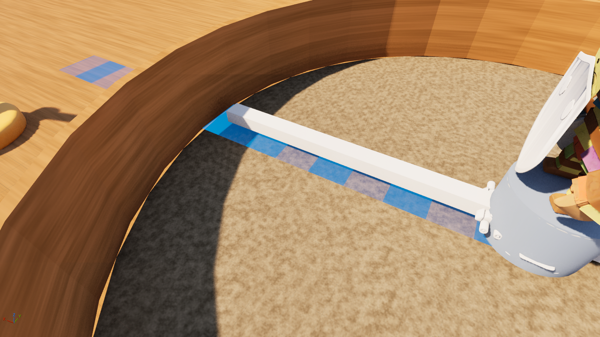

### 16:55 - Console - Polish, parts C and D: every screen, and the sound
Nothing neutral may be yellow, and three screens broke that rule: the end card's body text, the boss bar's "open" glow and its OPEN label. All three are paper cream now. The pause menu's orange focus became cream on brown, the grey engine Quit buttons went brown, the cut screen's hold bar fills in the colour of the feature you're cutting, and OPEN/CLOSED now sit on the boss bar itself instead of off to its right. The game's window is titled "Out of Scope". A line-by-line sound map found the boss's flame-arm attack had no sound at all and that a ring sound made for the boss had never been wired in; both now play.
No screenshots: none of these screens could be captured with their text by the agent's tools.

### 17:27 - Console - Polish, part two
PC felt a polish pass was still missing, so the skipped half of the afternoon went in. The long ruler that closes the arena now disappears once the boss climbs out of its bin, because from the game's camera it had been hiding most of the fight. Enemies no longer pop into a fight: they grow in from small with a puff of paper at their feet. The cork floors got finer, crisper flecks (the "seam" down the station platform turned out to be a wall's shadow), the chosen note on the cut screen tilts, a refilled heart pops in the HUD, and the boss sags a little further when it opens. What failed: a new title backdrop shot from the game looked worse than the cutting mat it would replace, so the mat stays; and asking Windows to treat the game as high-DPI wasn't enough on its own, so the game still starts at 1536 by 864 on a laptop set to 125%.

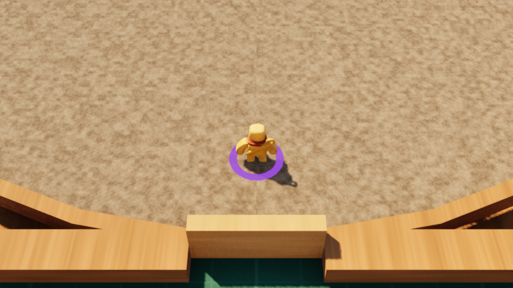

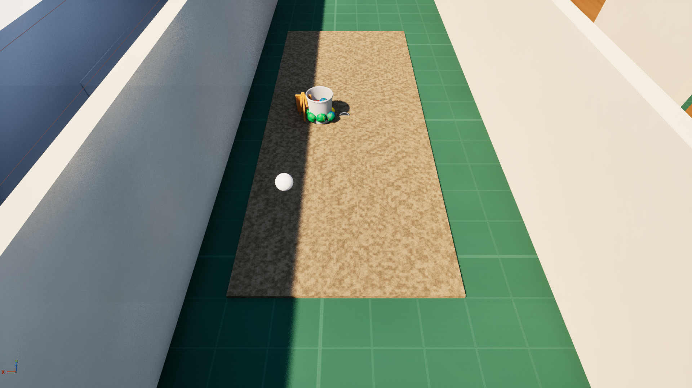

### 17:59 - Console - The boss gets its own voice, and the arena gets edges
The boss had been borrowing the hero's sounds: its jump used the hero's landing thud, its dash the hero's dash, its shield a hit sound. Codex made three of its own (a heavy toy landing, a skidding axle, a winding ratchet). PC approved them; Codex's command-line import produced nothing, so I ran its import script inside the editor and swapped the three sounds in. The blue warning lane for the boss's charge and its two flame arms used to reach over the desk past the arena wall whenever the boss stood off-centre. Both materials now fade out at the arena's circle; for the arms that meant a masked copy of the toy material, so nothing else changed. Index-card walls got faint ruled lines and ruler walls got tick marks, drawn by the existing surface material only on side faces. I chased one more sharpness lead in the engine source: it turned out to apply only to the editor, so the game still starts below native resolution on a 125% Windows display. Last came a slow walk from the first room to the arena from the game camera. It found nothing unfinished, just two framing questions for PC.

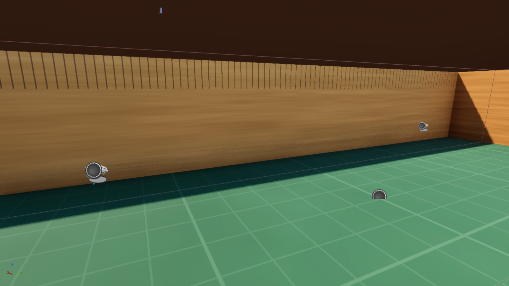

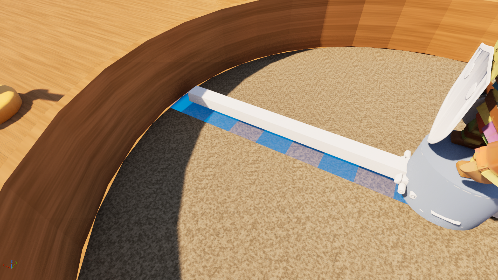

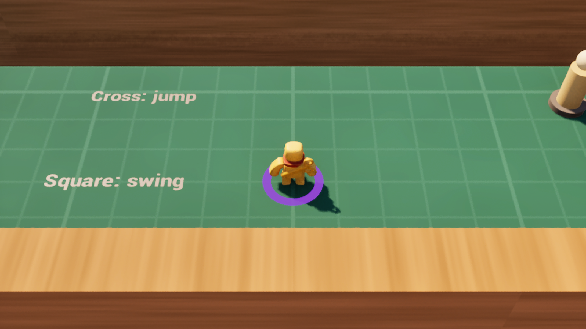

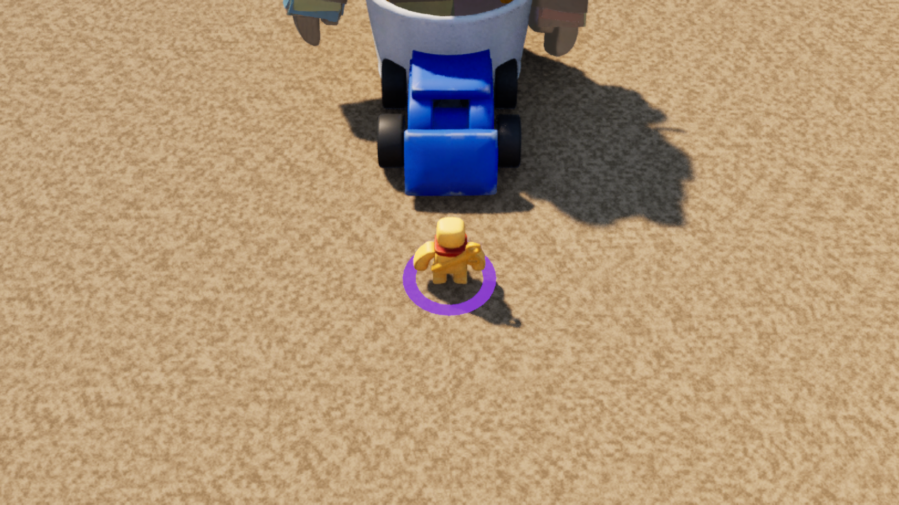

### 21:53 - Console - The juice pass: the theme said out loud, and the game felt in the hands
Two moments carry the theme, so now they say it. The boss's name card lists what it was built from, the player's three cuts in their colours, and every cut ends with a big tilted "CUT: FIRE" stamp while the room rebuilds without it. The killing blow plays half a second in slow motion. Every screen comes up out of a brown cover instead of snapping in. The title has the five sticky notes bobbing under the prompt, and the end card shows the kept notes clean and the cut ones struck through. With one heart left, the heart pulses and the screen edge stays faintly red. On a pad, six moments rumble: getting hurt, landing a swing (harder on the beat), the pen striking a note, the boss's landing and its final burst. On PC's ask, the pause menu gained a controls card that follows the last device used and strikes out cut features, and the end card counts how many of the ten possible bosses you've built. What failed: agents can't kill the boss in the editor tonight, so the slow motion and the boss count are checked by reading, not by playing. A bug caught on the way: the fade lived in an actor that stops ticking at pause, so it could freeze over the pause menu; it now runs in its own widget.

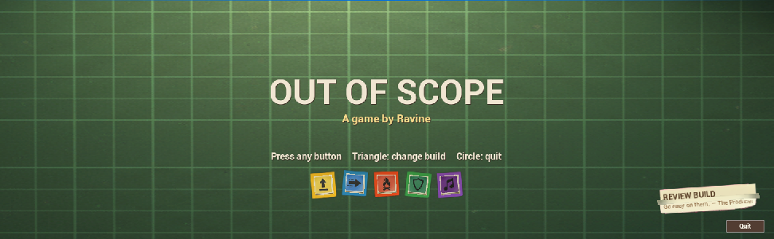

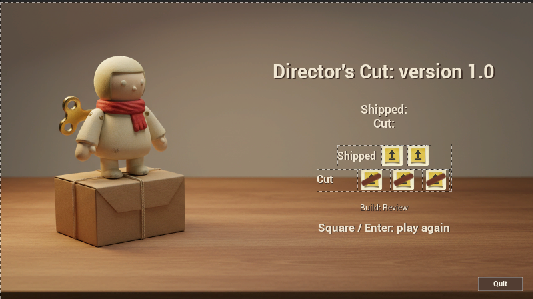

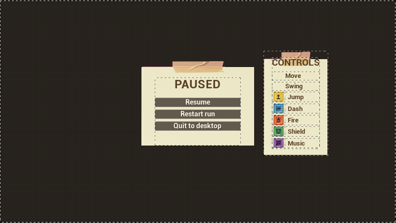

### 22:35 - Console - Last touches, and finally proving the night's work
The game is now sharp on scaled Windows displays without the player's help. The cause, found in the engine source an hour earlier: the game picks its resolution two seconds before it becomes DPI-aware, so a 125% desktop reads as 1536 × 864. The fix is six Blueprint nodes that re-apply the real desktop size on the first frame; a clean launch now writes 1920 × 1080. A "Boss: 1 HP" switch in the tuning panel let the boss be killed for the first time tonight, which proved the end card's note rows and the boss count, and caught one overlap (fixed). What failed: the swing never hurt the 1-HP boss; PC, at the keyboard, killed it with a fireball. Smaller touches: the hero flickers while he can't be hurt, the CUT stamp lands with a thunk, the boss's Shield chase glows green, the pad thumps only for the boss's leap, and a revive comes back through the same brown fade as the screens. The opening frame stays as it is: the first gate is too close to move the start.

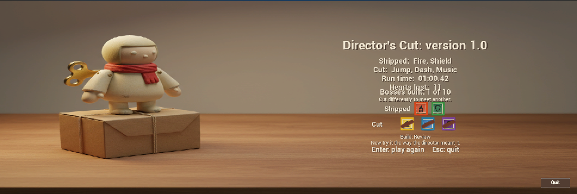

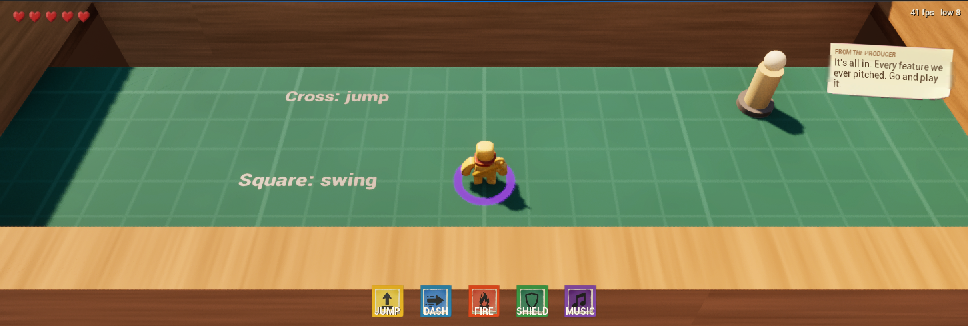

### 2026-11-14, looking back - Fable - The day the connection kept dropping
Saturday's plan was one polish pass and then a long playtest. It became six passes, because the day kept being taken away. The house network dropped packets all day, so agents lost their link mid-task; the builder agent ran out of its usage allowance twice, once for three hours; and the laptop ran short of memory whenever the editor and a packaged game were open together. What kept the work moving was the paperwork: every agent writes a journal entry after every step, so whichever agent came back, or whichever fresh session took over, could read where things stood and carry on. The lesson for the briefs came from the afternoon: the builder had spent hours trying to photograph effects that last half a second. From then on the rule was one try per picture, write "not seen", and let the human's playtest be the check. After that rule, the evening's four passes each finished inside half an hour.
