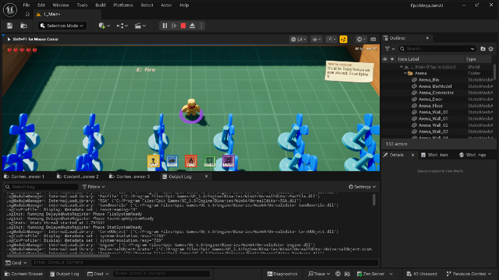
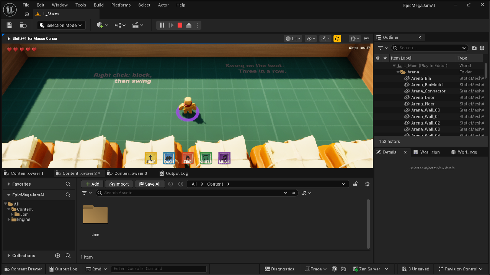

# Day 4 - Sun 15 Nov

### 08:35 - PC - The first full playtest of everything
PC played the build with all of Saturday's work in it and answered the whole test sheet, about a hundred lines. Nearly everything that six passes of agents had built without ever seeing it on screen worked: the boss's name card, the cut stamp, the slow-motion kill, the rumble, the blink, the boss count. Nine things didn't. The worst was one no agent could have found: the pause menu could not be used with a controller at all, only with the mouse, so a pad player who paused could never resume. Agents can't hold a pad.

### 10:15 - Console - Nine fixes, and the price of a sharp picture
The sharpness fix from the night before had a cost nobody measured until PC did: about 30 frames a second, down from 60. The game had been running fast only because Windows was secretly drawing it small and stretching it. Now that it really drew 1920 × 1080, the laptop's graphics card had more than twice the pixels to fill. The answer was a middle setting: draw the 3D picture at 70% and let the engine's upscaler bring it to full size, with the window and the interface at native resolution. PC measured 52 to 55, still sharp. The pause menu got its own stick-and-button handling in place of the engine's focus system. The ground that flickered inside the arena door was two floors at the same height. The Fire gate's "last puff" had been firing every frame for ever. And the beat ring had been drifting off the music because the beat clock ran on game time, which every hit briefly slows for impact; it now runs on the music's own time.

### 10:55 - Console - The bug that only the easy mode had
PC's check of those fixes found one more, in the forgiving "Review build" that judges get by default. If you keep dying, the producer cuts the fight for you with a note: "We don't have time for this." It worked in Rooms 1 and 2 and not in Room 3. The cause: Room 3's last fight is two waves chained together, and when the first wave was cut, its "start the next wave" step started the second wave even when that had been cut too. The note appeared and the enemies came back anyway. One flag fixed it. Three smaller things went in with it: the pause menu's controls card now shows the keys when you paused from the keyboard, the Music prompt moved to where the camera can see it, and the beat's click got louder.

### 11:08 - Console - A cold start, one step from the end
With the last fix saved and only the final package left, the builder agent ran out of usage. PC loaded a different account, and that session knew nothing: not the game, not the rules, not what had been done. It read the board, the last journal entries and the brief, found that everything was saved and that the debug tools were already off, took the exact command from the last package's log, and packaged the release candidate with no errors and without opening the editor. Then it zipped it without the debug file, unzipped the zip into an empty folder and started that copy to prove it runs. Under ten minutes from a cold start. The planning agent's one-page handoff for it was finished two minutes after it was done. A project run on written notes can change hands at any moment; this was the proof.

### 11:17 - PC - All tests pass
PC played the release candidate from the unzipped copy: debug tools gone, the four fixes right, a full run from the title to the end card on the pad. Everything passed. The game was frozen five hours ahead of our own deadline.

### How it was made, in one page
- **One human, several agents, one editor.** PC chose the idea, played every build on a PS5 pad and made every decision. A planning agent wrote the design and the briefs. A builder agent drove the Unreal editor through Unreal MCP. A third made the art and synthesised every sound and the music in Python. A fourth ran the browser tools. Only one of them could touch the editor at a time, so they passed a "baton" on a shared board.
- **Everything is written down.** A board says who is doing what. A journal gets an entry after every step, in plain Blueprint terms, so PC can open any graph and follow what changed. Briefs give exact numbers and a time limit per item. That is the whole method, and it is why usage limits, dropped connections and cold starts cost minutes, not days.
- **Agents can't see or feel.** They can't hold a button, feel a rumble or hear a mix, and effects shorter than a second are invisible to them. So they proved things by reading values, said plainly what they had not seen, and PC's playtests were the real check. Most of the bugs worth finding were found by a person with a pad.
- **Consistency came from rules, not taste.** One style sentence in every image prompt, image first and 3D second, one reviewer, one colour per feature and that colour nowhere else. Even fire may never be yellow, because yellow is Jump's.
- **The theme did the scoping.** The game is about cutting features to ship. So was the jam: DLSS, a title backdrop, a gate wobble and a fourth room were all cut, and the game is better for the list of things it doesn't have.
