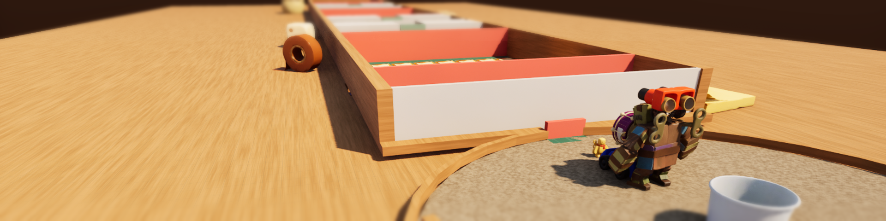

# Out of Scope: dev log

**Team Ravine · 2026 Epic AI MegaJam · theme "Director's Cut"**

*Out of Scope* is a tabletop action game made in four days by one developer and a team of AI agents, in Unreal Engine 5.8.3, Blueprint only. You start with five features and cut three. Each cut removes the ability and its half of the world, and the boss is built from what you cut.

This log was written as the game was made. Every entry says what was tried, what failed and what changed.

| Day | What happened |
|---|---|
| [Day 0, Wed 11 Nov](Day-0.md) | Setup, the theme, the idea |
| [Day 1, Thu 12 Nov](Day-1.md) | The hero, the cut, three rooms and the boss |
| [Day 2, Fri 13 Nov](Day-2.md) | The look, the screens, the review build |
| [Day 3, Sat 14 Nov](Day-3.md) | The boss dies, effects, dressing, polish |
| [Day 4, Sun 15 Nov](Day-4.md) | The playtest, the last fixes, the release |

Play the game: [*link added on release*](https://pcravine.itch.io/out-of-scope)

